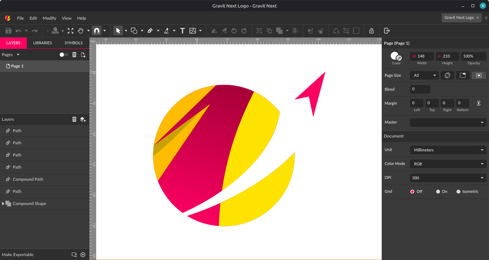
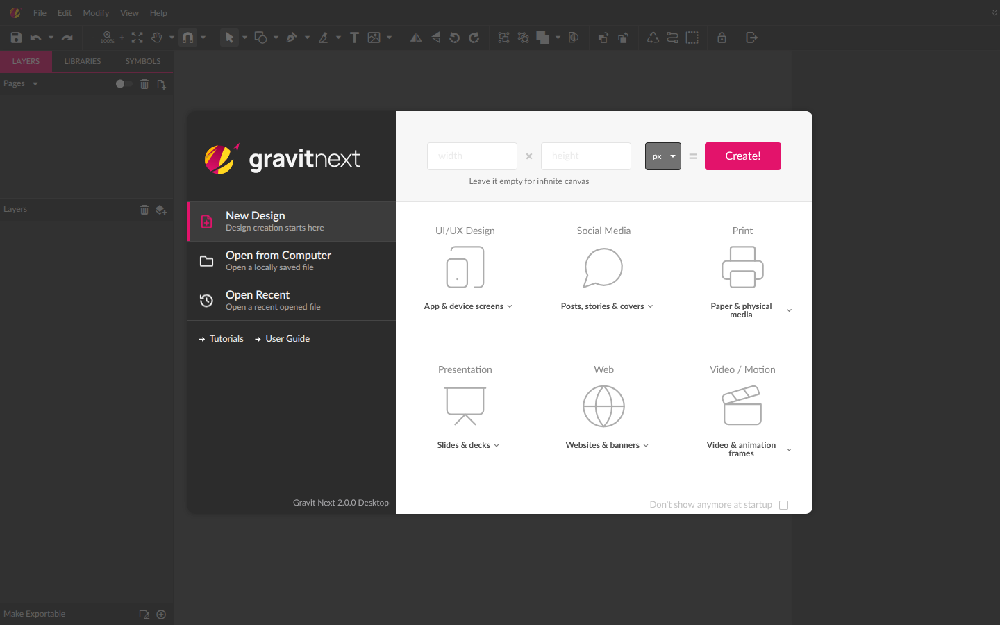
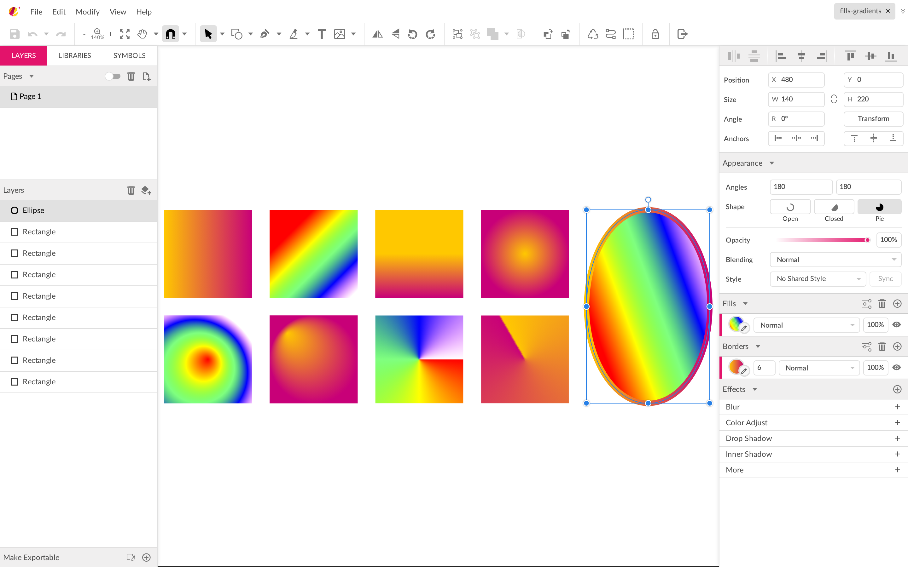
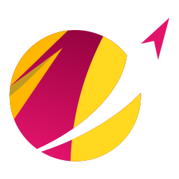

<p align="center">
  <picture>
    <source media="(prefers-color-scheme: dark)" srcset="docs/readme/logo-dark.png" />
    
  </picture>
</p>

<p align="center">A free, offline vector design app that opens your Gravit Designer files.</p>

<p align="center">
  <a href="https://github.com/GravitDesign/designer/releases"></a>
  
  
  <a href="https://github.com/GravitDesign/designer/issues"></a>
</p>

<p align="center">
  
</p>

Gravit Next is a community rebuild of Gravit Designer. It looks and
works much like the app you know, but it's a different app, made by
different people, rewritten in TypeScript and React.

It runs on your computer and works offline. There is no account, no cloud
and no subscription. It reads and writes Gravit's `.gvdesign` files.

## What you get

- **The editor you know.** Pages, layers, symbols, shared styles, fills,
  borders, effects, text on paths and the rest of the Gravit toolset.
- **Your files, on your disk.** Open and save `.gvdesign`, import SVG,
  PDF, Illustrator (.ai), EPS, Sketch and images (HEIC too), export PNG, JPG, SVG and PDF.
- **Everything unlocked.** All features are part of the app.
- **A desktop app.** An Electron app for Windows, Linux and macOS.
- **Light and dark.** Both themes, in the Next look or the classic one.
- **Thumbnails in Explorer.** On Windows, `.gvdesign` files show a preview
  instead of a generic icon.

<table>
  <tr>
    <td width="50%">
      
    </td>
    <td width="50%">
      <picture>
        <source media="(prefers-color-scheme: dark)" srcset="docs/readme/gradients-dark.png" />
        
      </picture>
    </td>
  </tr>
  <tr>
    <td align="center">Start from a preset or an infinite canvas</td>
    <td align="center">Gradients, fills and borders in the inspector</td>
  </tr>
</table>

## What's new

- **Guides.** The guide tools are back: drag guides out of the rulers,
  Manage Guides, Lock Guides, and a movable ruler origin.
- **Updated help.** The user guide is rebranded as Gravit Next, covers the
  guide tools, and no longer describes features the app dropped (cloud
  sync, sharing, comments and cloud templates). Its links all work from
  inside the app.
- **Illustrator import.** Open, place or drop Adobe Illustrator (`.ai`)
  files. Files saved with PDF compatibility, which is the default, import as
  vectors. Very old PostScript-based `.ai` files open through the EPS
  importer.
- **Desktop files.** Open and Save As with the system dialogs, a recent files
  list, and `.gvdesign` files that open from the file manager.

## What's gone

Cloud sync, sharing and comments, and templates from the cloud. They
depended on Corel's servers. Something else broken or different from what
you're used to? Please [open an issue](https://github.com/GravitDesign/designer/issues).

## Download

Get the installer for your system from the
[releases page](https://github.com/GravitDesign/designer/releases).

## Run it from source

Needs Node.js 22.12 or newer.

```sh
npm ci
npm run electron   # builds, then opens the desktop app
```

To see the classic look, start it with `GD_BRANDING=classic`.

## Tests

```sh
npm test           # unit tests
npm run lint
npm run typecheck
```

## Layout

- `src/`, `server/`, `electron/`: the app (`server/` is the small static server the desktop app embeds)
- `docs/FEATURES.md`: what the app does beyond the menus
- `src/assets/`: images, fonts, icons and data the app loads at runtime
- `docs/guide/`: the user guide, opened inside the app
- `electron/native/gvthumb/`: the Windows Explorer thumbnail provider
- `public/brand/`: the Gravit Next logo, colours and font

## Brand



**Freedom lies beyond the limits.**

The mark is a rocket escaping the bounds of gravity into an expanse of
freedom. The sky is no longer the limit.

**GravitNext: boundless, limitless and yours in freedom.**

Guides you can place at an exact position, lock and manage. Illustrator
files you can open and edit. Documents that stay on your own disk, with no
account, no cloud and no subscription in the way. Each of these removes a
limit, and the room it frees up is where your best work happens.

The colours are yellow `#FFD81F`, magenta `#E3136B` and ink `#2C2C2C`, and
the type is [Manrope](https://fonts.google.com/specimen/Manrope).

<br clear="left" />
